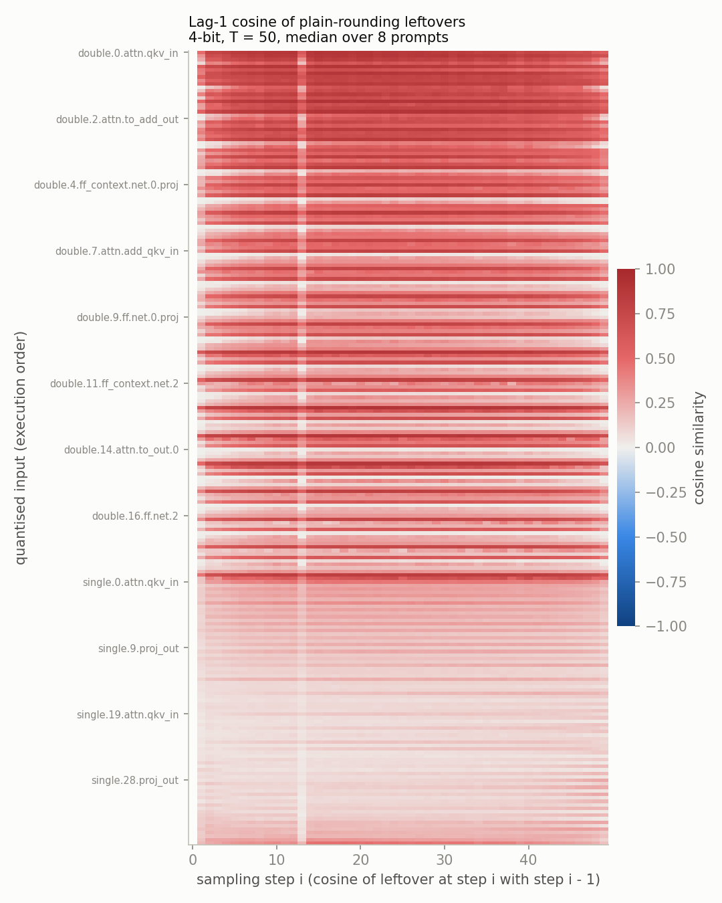
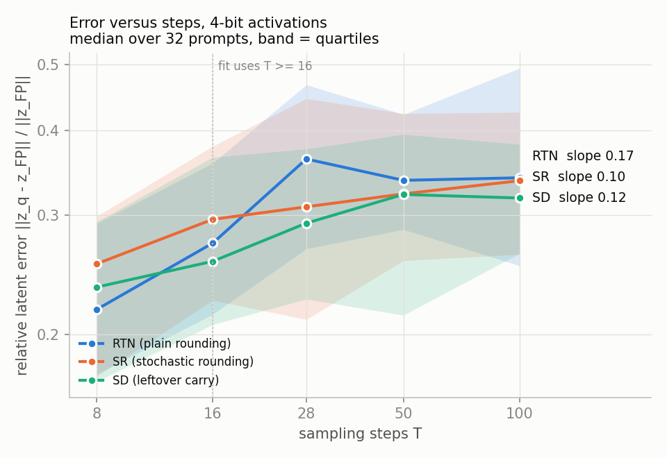
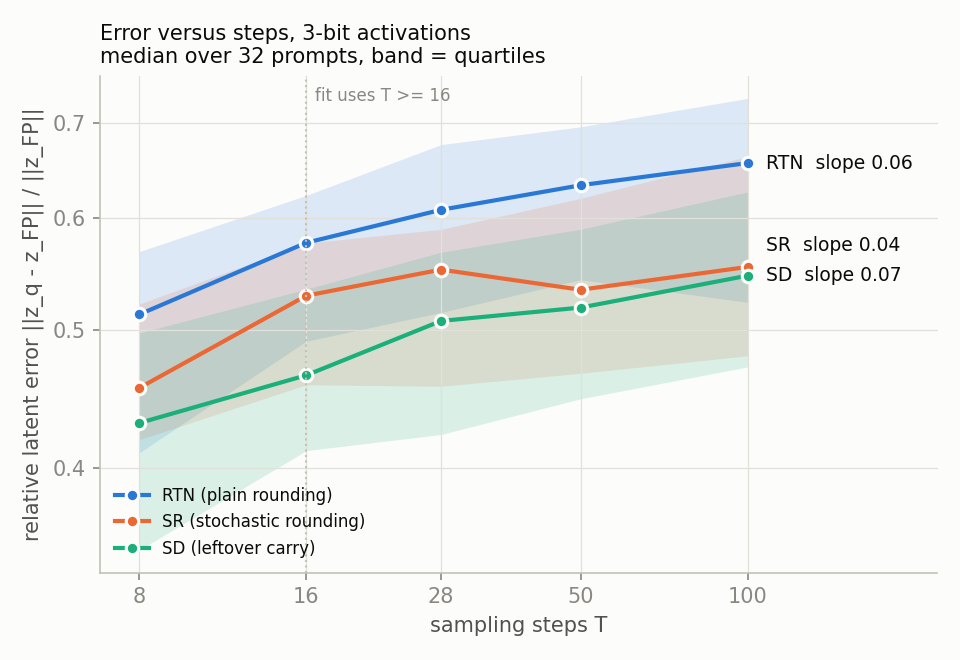

# E1 report: Steps Buy Bits go/kill experiment

Generated 2026-11-08T01:47:18Z by `scripts/make_report.py` from commit `76a7be4446c39aacfa2b046e224f92e6a8649f38` (uncommitted changes: False).

Model `black-forest-labs/FLUX.1-dev`, 512 x 512, guidance 3.5, default scheduler, seed = prompt index. Activations only are quantised (symmetric, per token, groups of 64 channels); weights stay BF16. Full precision at the same T is the reference.

## Verdict: **KILL**

- median lag-1 leftover cosine 0.270 is below 0.3
- SD error at T = 50 is 0.905 x RTN, at or above 0.8

Stop here, as agreed in the decision table.

## Decision table

| Check | Measured | GO if | KILL if | Status |
|---|---|---|---|---|
| E1.1 median lag-1 leftover cosine (b = 4, T = 50) | 0.270 | >= 0.5 | < 0.3 | KILL |
| E1.2 RTN slope (b = 4) | 0.17 [0.00073, 0.21], 32 prompts | between -0.3 and 0.1 | <= -0.4 (premise wrong) | neither |
| E1.2 SD slope (b = 4) | 0.12 [-0.01, 0.21], 32 prompts | <= -0.6 | > -0.3 | KILL |
| E1.2 SD latent error at T = 50, b = 4 | 0.905 x RTN (rel_err); LPIPS SD 0.193 vs RTN 0.221 | <= 0.5 x RTN and lower LPIPS | >= 0.8 x RTN | KILL |
| E1.3 step-ratio gamma vs unscaled (median rel_err) | T = 28: SD 0.292, unscaled 0.295; T = 50: SD 0.322, unscaled 0.321 | step-ratio at least as good | informative | not OK |
| SR slope (b = 4), for the WEAK rule | 0.10 [-0.02, 0.17], 32 prompts; SD error at T = 50 is 0.972 x SR | | | info; intervals overlap: True; SD not lower than SR: False |

### How the checks are computed (rules confirmed on 7 Nov 2026)

- Error: rel_err = ||z_q - z_FP|| / ||z_FP|| (unsquared) for every check, against FP at the same T. The CSV also keeps the squared form rel_err_sq.
- Slopes: least squares of log(rel_err) on log(T) for T >= 16, per prompt; the median over prompts with a 2000-sample bootstrap 95% interval.
- SD versus RTN at T = 50: median over prompts of the per-prompt ratio of rel_err. LPIPS check: median LPIPS of SD below that of RTN.
- Slope and ratio checks use b = 4; 3-bit results are reported below but do not decide.
- RTN slope: GO between -0.3 and 0.1; at or below -0.4 the premise is wrong (KILL); between -0.4 and -0.3 gives UNDECIDED.
- WEAK: SD beats RTN at T = 50 and either the bootstrap intervals of the SD and SR slopes overlap or SD's error at T = 50 is not lower than SR's (median per-prompt ratio at or above 1). WEAK overrides GO.
- Overall KILL: cosine below 0.3, SD at or above 0.8 x RTN, or the RTN premise rule. An SD slope above -0.3 shows as a KILL cell but on its own gives UNDECIDED. UNDECIDED means neither GO nor KILL fired; read the plots.

## E1.1 Leftover correlation

Mode RTN, b = 4, T = 50, 8 prompts (ids 0 to 7), 228 quantised inputs, 65536 sampled entries per input (seed 0). Statistics pool layers, steps and prompts.

| Lag | Median cosine | Quartiles | Values |
|---|---|---|---|
| 1 | 0.270 | 0.120 to 0.542 | 89376 |
| 2 | 0.213 | 0.090 to 0.449 | 87552 |
| 5 | 0.124 | 0.043 to 0.299 | 82080 |
| 10 | 0.067 | 0.020 to 0.188 | 72960 |

Drift ratio ||a_i - a_(i-1)|| / ||s_i||: median 0.390 (quartiles 0.156 to 0.803). Values well below 1 mean neighbouring steps move by less than one quantisation step.

| Input kind | Median lag-1 cosine | Quartiles |
|---|---|---|
| `double.*.attn.qkv_in` | 0.375 | 0.288 to 0.521 |
| `double.*.attn.add_qkv_in` | 0.684 | 0.597 to 0.774 |
| `double.*.attn.to_out.0` | 0.064 | 0.024 to 0.165 |
| `double.*.attn.to_add_out` | 0.255 | 0.169 to 0.351 |
| `double.*.ff.net.0.proj` | 0.247 | 0.155 to 0.543 |
| `double.*.ff.net.2` | 0.385 | 0.329 to 0.468 |
| `double.*.ff_context.net.0.proj` | 0.779 | 0.723 to 0.832 |
| `double.*.ff_context.net.2` | 0.479 | 0.377 to 0.599 |
| `single.*.attn.qkv_in` | 0.137 | 0.077 to 0.228 |
| `single.*.proj_out` | 0.116 | 0.084 to 0.173 |

## E1.2 Error versus steps

32 prompts. Median relative latent error rel_err over prompts (FP at the same T is the reference):

2 of 960 runs ended with a non-finite latent and are left out of the medians, slopes and ratios: prompt 4, T = 100, SD, b = 4; prompt 9, T = 50, SD, b = 4.

**b = 4**

| Mode | T = 8 | T = 16 | T = 28 | T = 50 | T = 100 | Slope (95% interval) |
|---|---|---|---|---|---|---|
| RTN | 0.2176 | 0.2726 | 0.3629 | 0.3375 | 0.3405 | 0.17 [0.00073, 0.21], 32 prompts |
| SR | 0.2541 | 0.2956 | 0.3085 | 0.3223 | 0.3371 | 0.10 [-0.02, 0.17], 32 prompts |
| SD | 0.2348 | 0.2563 | 0.2918 | 0.3217 | 0.3178 | 0.12 [-0.01, 0.21], 32 prompts |

At T = 50: RTN PSNR 18.90 dB, LPIPS 0.221; SR PSNR 18.83 dB, LPIPS 0.190; SD PSNR 19.38 dB, LPIPS 0.193 (medians over prompts, against FP at the same T).

**b = 3**

| Mode | T = 8 | T = 16 | T = 28 | T = 50 | T = 100 | Slope (95% interval) |
|---|---|---|---|---|---|---|
| RTN | 0.5128 | 0.5761 | 0.6076 | 0.6323 | 0.6555 | 0.06 [0.03, 0.08], 32 prompts |
| SR | 0.4552 | 0.5287 | 0.5515 | 0.5338 | 0.5539 | 0.04 [0.02, 0.05], 32 prompts |
| SD | 0.4301 | 0.4647 | 0.5075 | 0.5186 | 0.5461 | 0.07 [0.04, 0.10], 32 prompts |

At T = 50: RTN PSNR 13.56 dB, LPIPS 0.562; SR PSNR 15.40 dB, LPIPS 0.579; SD PSNR 15.72 dB, LPIPS 0.547 (medians over prompts, against FP at the same T).

## E1.3 Step-size matching ablation

| T | SD median rel_err | SD unscaled median rel_err | Unscaled / SD |
|---|---|---|---|
| 28 | 0.2918 | 0.2946 | 1.009 |
| 50 | 0.3217 | 0.3209 | 0.997 |

On a smooth schedule neighbouring step sizes differ by a small amount, so the unscaled carry is expected to be close to the step-ratio carry; the difference grows with how uneven the steps are.

## E1.4 Overhead

b = 4, T = 50, prompts 0 to 3. Times are for fake quantisation in PyTorch, for information only. Buffer sizes are exact sums over the leftover buffers; peak memory is torch.cuda.max_memory_allocated.

| Run | Leftover buffers (GB) | Without input sharing (GB) | Extra peak vs RTN (GB) | Step time (s) | Time vs RTN | Median rel_err | Error vs RTN |
|---|---|---|---|---|---|---|---|
| FP | 0.000 | 0.000 | -0.247 | 0.3212 | 0.668 | 0.0000 | n/a |
| RTN | 0.000 | 0.000 | 0.000 | 0.4811 | 1.000 | 0.3355 | n/a |
| SD_fp32 | 6.814 | 9.683 | 6.956 | 0.5915 | 1.230 | 0.3910 | 1.165 |
| SD_bf16 | 3.407 | 4.841 | 6.400 | 0.6085 | 1.265 | 0.3941 | 1.175 |
| SD_int8 | 1.757 | 2.496 | 2.994 | 0.7026 | 1.460 | 0.4020 | 1.198 |
| SD_int4 | 0.905 | 1.286 | 1.343 | 0.8073 | 1.678 | 0.4037 | 1.203 |

## Provenance

- Report commit: `76a7be4446c39aacfa2b046e224f92e6a8649f38`; result files record the commit of the run that wrote them.
- e1_corr.json: commit e8398df20ab51e156fd0c06014c53a183824a108, finished 2026-11-07T17:17:19Z
- e1_law.csv: 960 rows, commits ['e8398df20ab51e156fd0c06014c53a183824a108']
- e1_ablation.csv: 128 rows, commits ['e8398df20ab51e156fd0c06014c53a183824a108']
- e1_overhead.json: commit e8398df20ab51e156fd0c06014c53a183824a108
